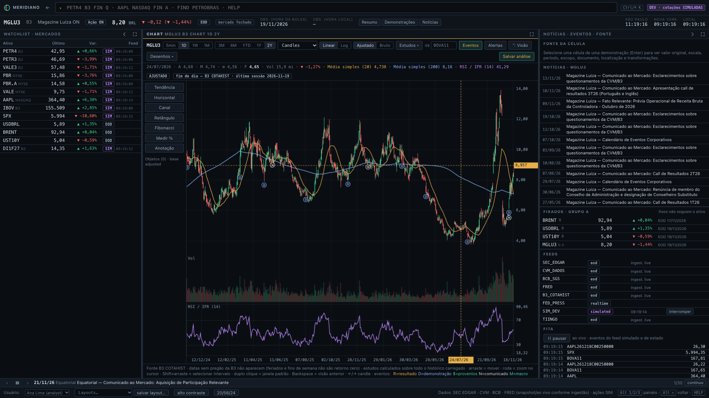
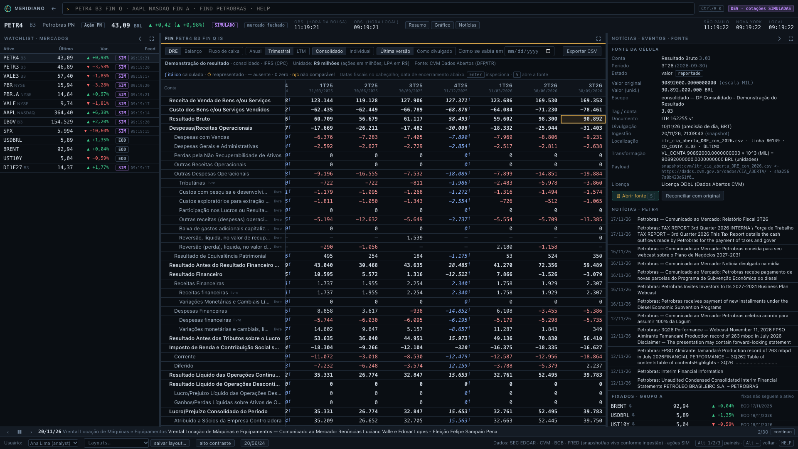
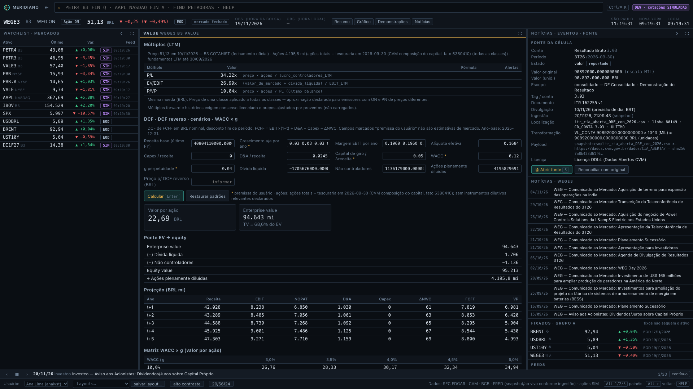
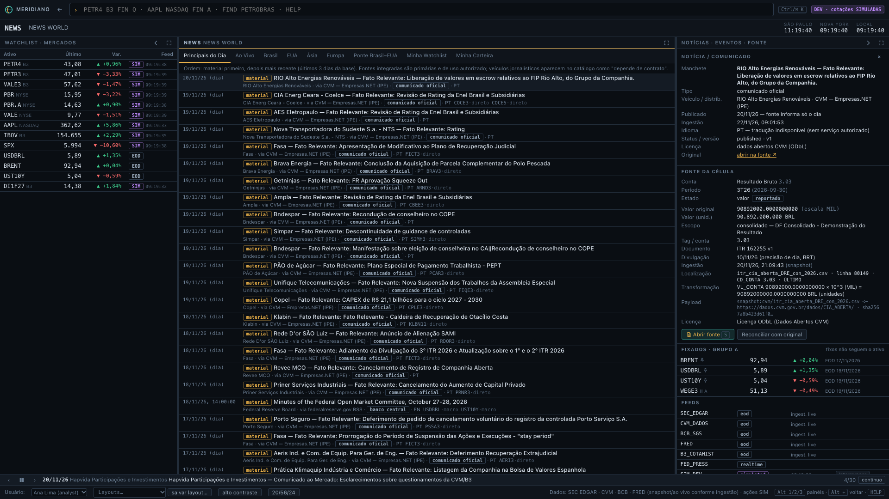
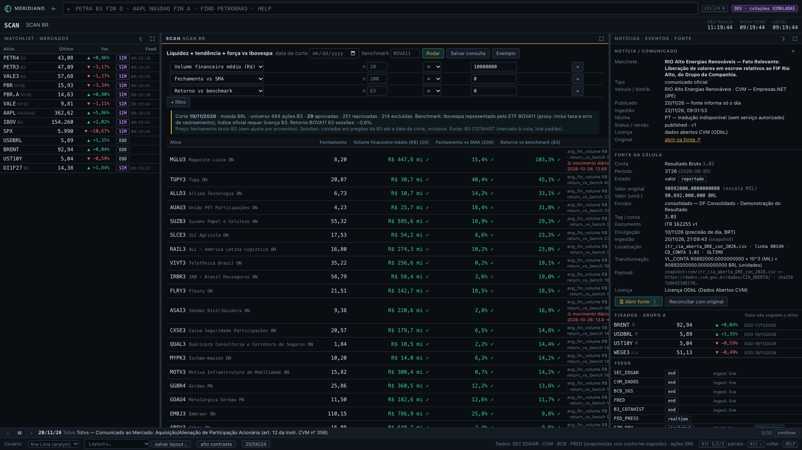

# Meridiano — terminal de mercado Brasil · EUA

Terminal pessoal de mercado, feito para estudar e acompanhar o mercado todos os dias: monitor Brasil–EUA, busca em
todas as companhias abertas da B3, gráfico com análise técnica e eventos, demonstrações financeiras da CVM e da SEC com a
fonte de cada número, valuation (múltiplos e DCF), comparação, notícias, rastreador de ações e séries macro.
Só fontes oficiais e abertas (B3, CVM, SEC, Banco Central, FRED); cada valor na tela é rastreável até o arquivo de origem.



| | |
|---|---|
|  |  |
|  |  |

**Como usar:** veja o [MANUAL.md](MANUAL.md) (comandos, teclado, leitura das células, fontes, feeds, DCF, tese).

> Projeto pessoal e de estudo, sem ligação com a Bloomberg ou qualquer provedor de dados. Preços de fim de dia (B3
> COTAHIST); as cotações "ao vivo" da tela são **simuladas** e marcadas como tal. Nada aqui é recomendação de investimento.

## Rodar do zero

Requisitos: macOS ou Linux, Python ≥ 3.9, Node ≥ 18 e ~10 GB livres em disco.

```bash
git clone https://github.com/rabelosphill/meridiano-terminal.git meridiano
cd meridiano
./run.sh            # cria o ambiente, baixa os dados, monta a interface e abre em http://127.0.0.1:8000
```

Na primeira execução:
- As cotações da B3 **não vêm no repositório**: o app baixa os arquivos oficiais `COTAHIST` direto do site da B3
  (~270 MB, alguns minutos). Os demais dados de exemplo (SEC, CVM, BCB, FRED, comunicados) estão em `data/snapshot`.
- Para carregar **todas** as companhias da B3 (cadastro, demonstrações e fatos relevantes da CVM), rode depois
  `.venv/bin/python -m backend.worker ingest weekly --mode live` (~10 min).
- Preços diários de ações americanas são opcionais e exigem uma chave gratuita do [Tiingo](https://www.tiingo.com):
  copie `.env.example` para `.env` e preencha `TIINGO_API_KEY`. **Nunca publique o seu `.env`.**

## Executar

```bash
./run.sh            # auto: tenta as fontes ao vivo e cai para o snapshot real identificado
./run.sh snapshot   # 100% offline, a partir de data/snapshot (dados reais coletados em 20/11/2026)
```

Abre em http://127.0.0.1:8000. Requisitos: Python ≥ 3.9 e Node ≥ 18. Sem `DATABASE_URL`, sobe um
PostgreSQL 16 embutido (`pgserver`) em `./.pgdata`; em produção, aponte `DATABASE_URL` para seu Postgres.
Configuração: `.env.example` (sem segredos). Usuário de desenvolvimento no rodapé (cabeçalho `X-User`).

Passos individuais:

```bash
.venv/bin/python -m backend.worker init                    # migrações SQL (backend/migrations) + cadastro
.venv/bin/python -m backend.worker ingest all --mode live  # ou: sec | cvm | macro ; --mode snapshot|auto
.venv/bin/python -m backend.worker status                  # execuções, contagens, quarentena
.venv/bin/python -m backend.worker replay                  # reprocessa a quarentena
.venv/bin/python -m pytest backend/tests -q                # critérios de aceite (banco de teste isolado)
.venv/bin/python scripts/bench_api.py                      # benchmark da API (servidor rodando)
```

Desenvolvimento da interface com recarga: `cd frontend && npm run dev` (proxy para a API em :8000).

## Comandos (primeiro ciclo)

| Comando | Exemplo | Sinônimos |
|---|---|---|
| HELP | `HELP FIN` | AJUDA, ? |
| MARKETS | `MARKETS BR US` | MERCADOS, MON |
| FIND | `FIND PETROBRAS` | BUSCAR, PROCURAR |
| OVERVIEW | `PETR4 B3 OVERVIEW` | DES, PERFIL, RESUMO |
| FIN | `PETR4 B3 FIN Q`, `AAPL NASDAQ FIN A`, `VALE3 B3 FIN LTM CF` | FA, DEMONSTRACOES; períodos A/ANUAL, Q/T/TRIM, LTM/TTM/U12M; IS/DRE, BS/BP, CF/DFC |
| FILINGS | `AAPL NASDAQ FILINGS` | DOCS, DOCUMENTOS |
| COMPARE | `COMPARE PETR4:B3 VALE3:B3`, `… CCY=USD` | COMPARAR |
| MACRO | `MACRO BR SELIC`, `MACRO BR IPCA`, `MACRO BR PTAX`, `MACRO US UST10Y`, `MACRO GLOBAL BRENT` | ECO |
| WATCH | `WATCH MINHA-MESA`, `WATCH MINHA-MESA +VALE3:B3` | LISTA |
| THESIS | `THESIS PETR4:B3` | TESE |
| DCF | `PETR4 B3 DCF` | VALUATION |

O registro (`backend/app/commands.py`) guarda sintaxe, sinônimos PT/EN, exemplos, tipos de ativo e grupo de
permissão. Comando incompatível explica o motivo e sugere alternativas (ex.: `USDBRL FIN` → "é moeda, sem
emissor com demonstrações"; sugere `MACRO BR PTAX`). A URL (`#cmd=…&cell=…`) representa o contexto
compartilhável sem dados privados.

**Teclado:** `Ctrl/⌘ K` busca · `Enter` executa · `Esc` volta ao foco anterior (e fecha o documento voltando à
célula) · setas percorrem células · `Enter` inspeciona · `S` ou `Shift+Enter` abre a fonte · `N`/`Shift+N`
próxima/anterior ocorrência no documento · `PgUp/PgDn` no painel focado · `Alt 1/2/3` foca painel ·
`Alt ←` comando anterior.

## Arquitetura

```
backend/
  migrations/         001 universo · 002 proveniência/fatos bitemporais/séries · 003 usuários/permissões/teses
  app/connectors/     base (limite por fonte, backoff, paginação, payload bruto, quarentena) · sec_edgar · ixbrl · cvm · macro (BCB, FRED)
  app/calc/           metrics (fórmula, unidade, convenção, versão, política de ausência; Decimal) · periods · returns · dcf
  app/services/       statements (A/Q/LTM, as-of, versões) · lineage · universe · quotes · permissions · research · templates
  app/api.py          FastAPI + SSE de cotações; serve o build da interface
  worker.py           worker de ingestão (CLI)
frontend/src/         React + TypeScript (Vite), sem bibliotecas de UI: grade virtualizada própria, ícones próprios
data/snapshot/        snapshot REAL com manifest.json (origem, sha256, instante da coleta, transformação)
data/objects/         armazenamento de objetos endereçado por conteúdo (interface compatível com S3)
```

**Modelo do universo.** `legal_entity` → `issuer` → `instrument` (classe, moeda, subjacente, atributos de
derivativos/renda fixa) → `listing` (ticker + bolsa + vigência) + `identifier` (CIK, código CVM, CNPJ, ISIN…
com vigência) + `adr_terms` (razão versionada) + `corporate_action`. O UUID do instrumento é a chave
persistente: `FB` (até 08/06/2022) e `META` resolvem para o mesmo instrumento (testado). Estão cadastrados
ON/PN, ADRs (PBR 1:2 ON, PBR.A 1:2 PN, VALE 1:1), índices, câmbio, título soberano (UST10Y CMT), futuro
(DI1F27, multiplicador e vencimento) e opção (AAPL C250, strike/tipo/multiplicador).

**Fatos bitemporais.** Cada valor guarda período de referência, instante de publicação, instante de ingestão,
versão do documento, fonte, moeda, unidade, escala, licença (via fonte), payload original e localização
(elemento iXBRL no 10-K; arquivo + linha + CD_CONTA no CSV da CVM). Reapresentação = nova linha; nada é
sobrescrito. "Como se sabia em D" filtra `published_at ≤ D`. Visões "última versão" e "como divulgado".

**Cuidados contábeis implementados.**
- Trimestre isolado a partir de YTD só com mesmo exercício, escopo, moeda e conta, e YTD do trimestre
  imediatamente anterior; senão a célula fica **ausente com motivo** (não é zero).
- Contas livres da CVM (`ST_CONTA_FIXA='N'`) mudam de código entre documentos — encontramos isso nos dados
  reais (Vale: "Adições ao Imobilizado" em códigos diferentes; no ITR 9M/2026 a linha virou "Adições ao
  Imobilizado **e investimentos**"). Linhas são casadas por conta-pai + rótulo normalizado; mudança de
  definição gera linha separada e o trimestre afetado não é calculado.
- Saldos nunca são somados entre períodos (LTM de saldo = último saldo; `sum_balances` falha por projeto).
- Convenção de sinal do sistema: despesas e saídas de caixa negativas; a inversão de sinal de tags US-GAAP é
  registrada como transformação na célula.
- Ausência e zero são estados distintos em toda a pilha (banco, API, grade, exportação).

## O que é real, snapshot ou depende de contrato

| Dado | Situação |
|---|---|
| Apple — fundamentos XBRL (24.480 fatos, 45 filings) e 5 10-K originais (FY2022–FY2026) | **Real**, SEC EDGAR; testado ao vivo e em snapshot |
| Petrobras e Vale — DFP 2022–2025, ITR 2024–2026, consolidado e individual (30.854 fatos) | **Real**, CVM Dados Abertos (snapshot filtrado das duas companhias, linha original preservada); conector também baixa os ZIPs ao vivo |
| Selic meta (SGS 432), IPCA (433), PTAX venda (1) | **Real**, BCB SGS; ao vivo e snapshot |
| Brent (EIA) e UST 10Y (H.15) via FRED | **Real**, fim de dia (conector extra além do pedido) |
| Cotações de ações, ADRs, índices, DI e opção | **SIMULADAS** (`SIM_DEV`), marcadas em toda a interface — não há contrato de bolsa |
| Consenso, notícias integrais, research, acionistas, cadeia de opções | **Dependem de contrato** — abas desativadas com o requisito exibido; nada é fabricado |
| Documento original CVM (PDF ENET) | Link para o RAD/ENET; a cópia armazenada é o CSV oficial estruturado |
| Horário de publicação CVM | `DT_RECEB` tem precisão de **dia** — exibido como tal |
| Instante de publicação de séries BCB/FRED | Fontes não informam por observação: regra documentada por série (`PUBLICATION_RULE`) |
| Calendários B3/NYSE 2026 | Cadastro manual (feriados oficiais 2026) |

## Critérios de aceite — resultado

`pytest backend/tests -q` → **22 passed** (banco PostgreSQL isolado, ingestão do snapshot real).

| | Verificação | Resultado |
|---|---|---|
| A | API: `PETR4 B3 FIN Q` e `AAPL NASDAQ FIN A` → célula → linhagem → fonte com destaque. **Navegador (teclado):** Ctrl+K → comando → Enter → `S` abre a linha 80141 do CSV ITR da CVM / o elemento `#f-76` (478.834) na DRE do 10-K → `Esc` volta com foco na mesma célula | ✔ |
| B | Reconciliação com o original: Apple receita FY2026 = "478,834" × 10⁶ USD, consolidado, 28/09/2025→26/09/2026; Petrobras 3.01 FY2025 = 497.549.000 × 10³ BRL (ESCALA MIL), "DF Consolidado", 01/01→31/12/2025; e todas as células reportadas das DREs anuais | ✔ |
| C | Apple: passivo fiscal diferido 24/09/2022 = 5.557 mi em D=30/06/2023 e 7.139 mi hoje; fluxo FY2021 5.799 → 7.475 mi. Vale: Provisões 31/12/2024 = 30.922 mi em D=01/03/2026 e 28.027 mi hoje (DFP 2025). Petrobras: caixa gerado nas operações 2024 260.414 → 260.492 mi | ✔ |
| D | Split 4:1 da Apple (31/08/2020) e dividendo não geram retorno; ajuste duplo falha; razão de ADR invertida e câmbio invertido falham na paridade; moeda errada levanta `CurrencyMismatch` | ✔ |
| E | **Navegador:** grade rolada 1.015 px vertical/108 px horizontal, foco na célula; 9 s de atualizações (13 cotações mudaram) → rolagem, foco e célula idênticos. Fita com pausa, contador de novidades e "ir para o mais recente" | ✔ |
| F | Feed interrompido mantém último preço com hora original e estado "interrompido", separado de "mercado fechado/feriado"; reprocessar o lote insere 0 linhas; revisão macro vira nova vintage; retentativa com backoff (503, 503, 200) e queda para snapshot sem rede | ✔ |
| G | `bia` (assessora) recebe 403 ao exportar fundamentos chamando a API diretamente; `ana` recebe o CSV; usuário desconhecido 401; tentativa negada vai ao `audit_log`; preço de feed sem permissão é removido | ✔ |
| H | Ver medições abaixo | ✔ |

### Medições (H)

Máquina: Apple M4, 10 núcleos, 16 GB, macOS 26 (Darwin 25.6), Python 3.9.6, PostgreSQL 16.2 local,
Chrome do painel do app. Volume: 55.334 fatos, 32.349 observações macro, 82 documentos, 16 listagens.

| Cenário | p50 | p95 | Meta |
|---|---|---|---|
| Sugestões locais, índice real (16 listagens + 11 comandos), 2.000 consultas | < 0,1 ms | 0,1 ms | < 200 ms |
| Sugestões locais, índice sintético de 10.000 listagens | 0,9 ms | 3,2 ms | < 200 ms |
| Sugestões locais, índice sintético de 50.000 listagens | 3,9 ms | 15,1 ms | < 200 ms |
| Abrir tela de demonstração já em cache (comando → grade no DOM), 24 aberturas alternando 4 telas | 44,7 ms | 54,3 ms | < 1 s |
| 1ª abertura dessas telas (cache frio do cliente) | — | 55–272 ms | — |
| API `statements` cache frio (27 telas) / quente (270) / parse de comando (200) | 29,8 / 8,5 / 16,7 ms | 67,9 / 26,1 / 22,1 ms | — |

Ressalva: durante a medição de telas o painel do navegador estava oculto (`visibilityState=hidden`); o tempo
vai até o commit no DOM, sem pintura. Reproduza com o painel visível via `window.__meridianoRun`.

## Entrega 2 — estação gráfica, notícias, eventos e rastreador

Novos comandos: `PETR4 B3 CHART 1D 2Y` (1º argumento = duração do candle, 2º = janela visível; minutos: `5MIN`),
`PETR4 B3 VALUE`, `PETR4 B3 PEERS`, `PETR4 B3 EVENTS`, `NEWS WORLD | LIVE | BR | US | ASIA | EU | BRIDGE | WATCH | PETR4:B3`, `SCAN BR`.
Ingestão: `python -m backend.worker ingest b3|news|us_prices|all --mode live|snapshot|auto`.

**Caminho completo verificado no navegador (Petrobras, dados reais):** `FIND PETROBRAS` → `PETR4 B3 CHART 1D 2Y` → + RSI(14)
→ `PETR4 B3 EVENTS` → ITR/6-K do 3T26 (12/11/2026) abre o gráfico no candle → clique no marcador mostra publicação
(10/11, precisão de dia) × 1ª sessão negociável → *Conferir fundamentos* (receita 3T26 = R$ 169.353 mi, com fonte por célula)
→ `Alt ←` volta ao gráfico no mesmo candle → *Salvar análise* (vira versão da tese com candle, estudos e eventos) →
`THESIS PETR4:B3` → *voltar ao ponto* reabre 12/11/2026 com o RSI 31,37.
**Apple:** busca, gráfico, eventos (8-K de resultados com horário), fundamentos e tese funcionam. Os preços vêm da
**Tiingo com a chave do usuário** (`TIINGO_API_KEY` no `.env`, fora do git): 726 sessões de 02/01/2024 a 20/11/2026,
OHLCV bruto + 12 proventos registrados em `corporate_action`; verificado em 20/11/2026. Sem a chave, o gráfico de ações
americanas mostra "indisponível" (não há fonte gratuita autorizada; Stooq exige verificação anti-robô, que não contornamos).
Para atualizar: `set -a && source .env && set +a && .venv/bin/python -m backend.worker ingest us_prices`.

| Dado | Situação |
|---|---|
| OHLCV diário de 790 listagens da B3, 2024–19/11/2026 (360 mil barras) | **Real** — B3 Séries Históricas (COTAHIST); `PREMED` = VWAP de sessão exato |
| OHLCV diário da AAPL, 2024–20/11/2026 | **Real, licenciado** — Tiingo com a chave do usuário; VWAP é aproximação (H+L+C)/3, declarada |
| Ibovespa | **Proxy declarado**: ETF BOVA11 (índice oficial requer licença B3) |
| Comunicados: 8-K/6-K SEC (Apple, Petrobras, Vale), IPE CVM (fatos relevantes, comunicados), press releases do Fed | **Real**, primários e de uso livre; SEC com horário (UTC), CVM só com data |
| Decisões do Copom | **Derivadas** da série SGS 432 (rótulo "derivado") |
| Reuters, Bloomberg, Dow Jones, FT, WSJ, Valor, Broadcast, Brazil Journal, Nikkei, Caixin, Handelsblatt, Les Echos | **Dependem de contrato** (catálogo na aba NEWS) |
| Tradução PT/EN, consenso (macro e de lucros), múltiplos forward | **Indisponíveis** sem serviço/fonte licenciada — nunca estimados |
| Proventos e fatores de ajuste da B3 | **Não carregados**: série "ajustada" só aplica eventos cadastrados; retornos são de preço. Saltos extremos com mudança de DISMES são excluídos do rastreador com o motivo |
| Intradiário | **SIMULADO** (barras de 1 min do feed dev, ancorado no último fechamento oficial) |

Gráfico próprio em canvas (sem biblioteca externa — sem restrição de licença/atribuição): candles, OHLC, linha, área;
zoom no cursor, arraste, seleção com Shift, escala log (recusa valores ≤ 0), visão anterior; painéis de estudo com eixo
próprio; linha de inspeção; 18 estudos com fórmula, parâmetros, fonte de preço e aquecimento declarados, calculados sobre
todo o histórico (zoom não altera valores); desenhos (tendência, horizontal, canal, retângulo, Fibonacci, medição, nota)
editáveis, bloqueáveis, ocultáveis e persistidos por usuário × instrumento × base de preço; alertas com condição explícita,
modo intrabar × fechamento e deduplicação; eventos clicáveis com instante de publicação × 1ª sessão negociável.

### Testes 1–10

`pytest backend/tests -q` → **32 passed** (22 da entrega 1 + 10 novos).

| # | Teste | Como foi verificado | Resultado |
|---|---|---|---|
| 1 | Manchete nova atualiza a faixa sem deslocar a tabela | Navegador: NEWS rolada a 700 px; 2 manchetes injetadas → faixa mostra a nova; 1ª linha visível idêntica (mesmo texto, y=137) | ✔ |
| 2 | Notícia após o fechamento | 8-K da Apple 02/11/2026 16:30:23 ET → sessão 03/11 ("após o fechamento"); 6-K Petrobras 23:33:09Z → 17/11 | ✔ |
| 3 | Split ajustado sem queda/alerta falso | Série TESTE 4:1: bruto −75% e alerta de mínima falso; ajustado ~0% e nenhum alerta; reajuste levanta erro | ✔ |
| 4 | Média e RSI vs referência; zoom | RSI(14) igual à tabela de Wilder (70,53 … 37,77); SMA exata; RSI e SMA200 da PETR4 idênticos com janela 3M e 2Y | ✔ |
| 5 | VWAP de sessão | B3: igual ao PREMED (VOLTOT/QUATOT, negócios individuais); intradiário reinicia na sessão seguinte e declara aproximação | ✔ |
| 6 | Rompimento só com sessões anteriores, 1 disparo | Referência exclui a barra atual; política `once` = 1; intrabar 1 por barra; reavaliar não duplica | ✔ |
| 7 | Data de corte | `as_of=2026-11-11`: sem barras, eventos ou notícias posteriores; DRE sem o 3T26 antes de 10/11 | ✔ |
| 8 | PETR4 → AAPL com resposta atrasada | Navegador: requisição da PETR4 com atraso de 3 s **abortada** (`ERR_ABORTED`); cabeçalho, gráfico e notícias = AAPL | ✔ |
| 9 | Layout salvo restaura tudo | Navegador: layout "Vale estudo" → VALE3, 1D/1Y, OHLC, log, ajustado, Bollinger + razão vs BOVA11, desenho e candle 15/10 | ✔ |
| 10 | Feed intradiário fora | `5MIN` → "interrompido — histórico diário segue disponível"; `1D` mantém barras, última sessão 19/11 e granularidade | ✔ |

Medido (Apple M4, mesmo ambiente): `/api/chart` da PETR4 com 722 barras e 5 estudos ≈ 100 ms; rastreador de exemplo
sobre 489 ações ≈ 1,4 s; sugestões e abertura de telas como na entrega 1.

## Universo Brasil completo (CVM)

`python -m backend.worker ingest universe_br` cadastra **todas as companhias abertas** a partir do cadastro oficial da
CVM (razão social, nome comercial, código CVM, CNPJ, setor) e liga cada ticker da B3 à sua empresa pelo **FCA — valores
mobiliários** da CVM (classe e tipo continuam vindo do registro da B3). Resultado em 21/11/2026: 680 companhias, 400
tickers da B3 ligados; os demais ~390 ativos são ETFs/fundos ou tickers sem companhia aberta correspondente. Colunas de
pessoas físicas do cadastro (responsável, e-mail, telefone) são descartadas antes de qualquer armazenamento.

`python -m backend.worker ingest cvm` passou a carregar DFP/ITR de **todas** as companhias (COPY em lote; contas até o
3º nível; DMPL/DVA não são lidas). A busca encontra pelo ticker, pelo nome abreviado da B3 ou pelo nome da empresa
("magazine luiza", "itaú unibanco"), com ações antes de fundos. Fundamentos, eventos, comunicados (IPE), VALUE/DCF e
tese funcionam para qualquer empresa ligada. Pacote setorial inferido do setor de atividade da CVM.

Quantidade de ações: a CVM não informa a escala na composição do capital; quando preço × ações ÷ PL < 0,01 e ×1000 dá
um P/VP plausível, o sistema multiplica por 1.000 e mostra **"ESCALA INFERIDA"** junto ao número.

## Atualização automática (launchd)

Três rotinas rodam sozinhas no Mac (horário local), mesmo com o app fechado; se o Mac estiver dormindo, rodam ao acordar:

| Rotina | Quando | O que faz | Custo |
|---|---|---|---|
| `news` | a cada 30 min | 8-K/6-K novos na SEC (só baixa filings ainda não vistos), Fed, Copom | ~1–3 s |
| `daily` | 07:00 e 20:30 | arquivos diários da B3 dos últimos 7 dias (~500 KB cada), preços AAPL (Tiingo), fundamentos SEC, Selic/IPCA/PTAX/Brent/UST10Y | ~15 s |
| `weekly` | domingo 09:00 | cadastro de companhias e tickers (CVM/FCA), DFP do ano anterior e ITR do ano corrente de todas as companhias, fatos relevantes/comunicados (IPE) | ~2 min |

Tudo é idempotente (rodar de novo não duplica) e cada rotina tem trava contra execução simultânea.
Resultado de cada execução em `logs/update.log` (só contagens; a chave da Tiingo nunca é gravada) e no painel
**Feeds** do app (última ingestão por fonte). Arquivos: `scripts/update.sh` e `~/Library/LaunchAgents/com.meridiano.update.{news,daily,weekly}.plist`.

```bash
tail -20 ~/meridiano/logs/update.log                                   # últimas execuções
launchctl kickstart gui/$(id -u)/com.meridiano.update.daily              # rodar agora
launchctl bootout gui/$(id -u)/com.meridiano.update.news                 # desligar (repita para daily/weekly)
```

Para religar, `launchctl bootstrap gui/$(id -u) ~/Library/LaunchAgents/com.meridiano.update.news.plist`. Para mudar
horários, edite o `.plist` e rode `bootout` seguido de `bootstrap`. O servidor do app (`uvicorn`) não é agendado —
abra-o quando for usar; as rotinas atualizam o banco independentemente.

## Limitações conhecidas e próximos passos

- Autenticação de desenvolvimento por cabeçalho; trocar por OIDC/SSO mantendo `current_user`.
- Templates US-GAAP cobrem as linhas principais; tags fora do template ficam em `statement='OTHER'`.
- Pacotes setoriais: métricas não estruturadas (produção, realização de preço, lifting cost, C1) exigem
  conector de RI; bancos/seguros exigem template COSIF/SUSEP.
- Próximos conectores: IBGE, Tesouro Nacional, U.S. Treasury, BLS, BEA, ALFRED (vintages), ECB, Eurostat, BIS,
  FMI, OCDE, Banco Mundial, EIA, USDA; bolsa/consenso/notícias apenas com contrato documentado.
- Fora desta entrega: renda fixa analítica, cadeia de opções e gregas, curvas, carteira, paper trading/OMS e
  pesquisa assistida por IA (a biblioteca determinística e a linhagem já servem de base).

## Licença

Código sob a licença MIT (veja [LICENSE](LICENSE)) — © 2026 [Fellipe Rabelo](https://www.linkedin.com/in/fellipe-rabelo-8448a857/). Os dados baixados continuam sujeitos aos termos de cada fonte
(B3, CVM, SEC, Banco Central, FRED, Tiingo).
